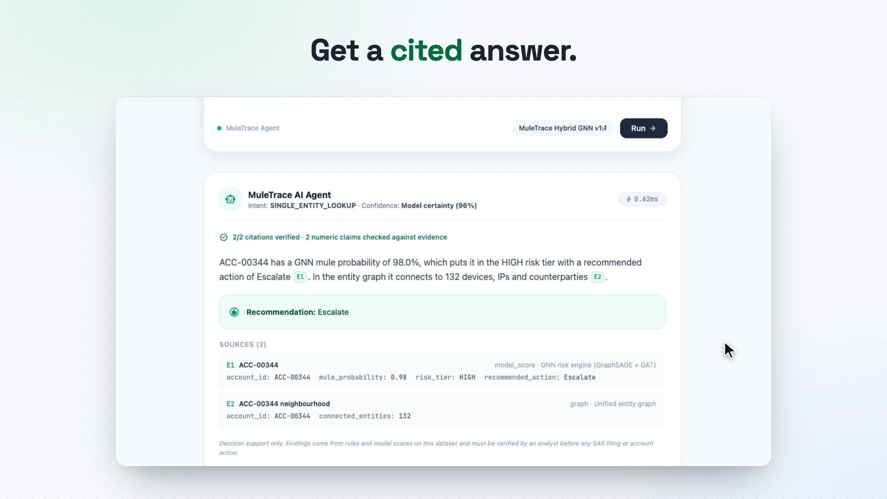
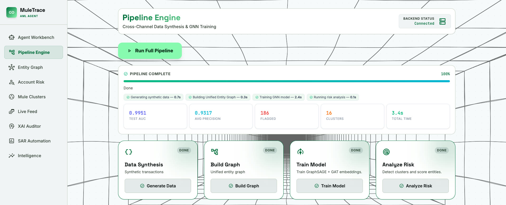
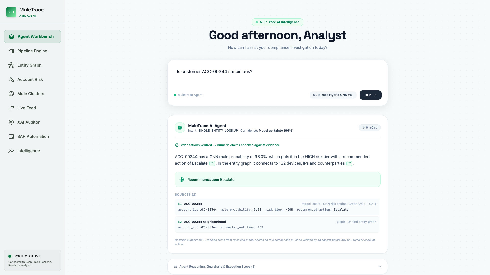
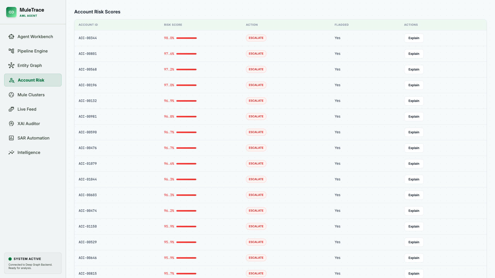
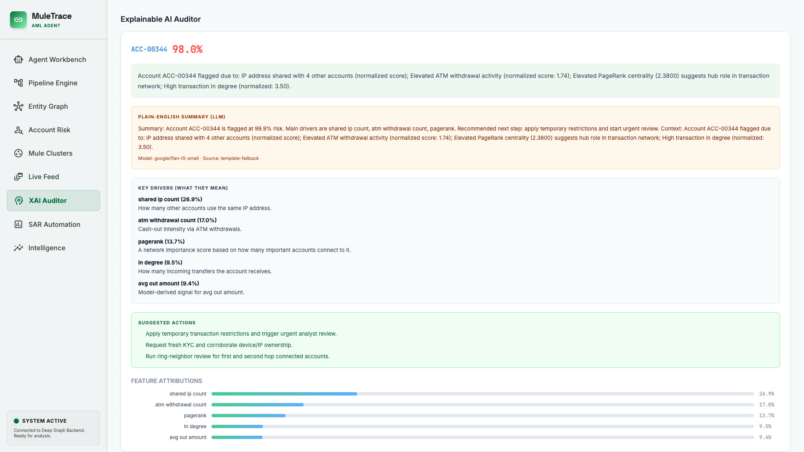
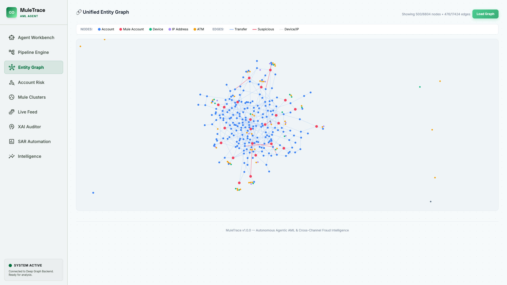
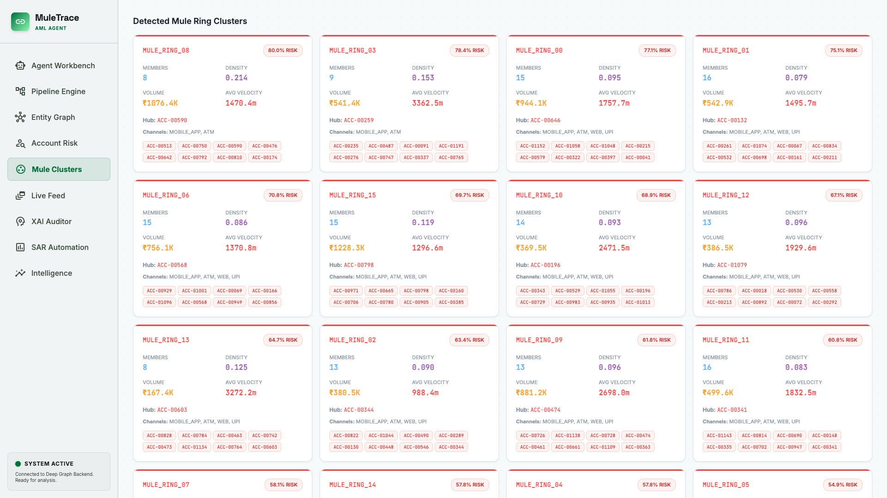
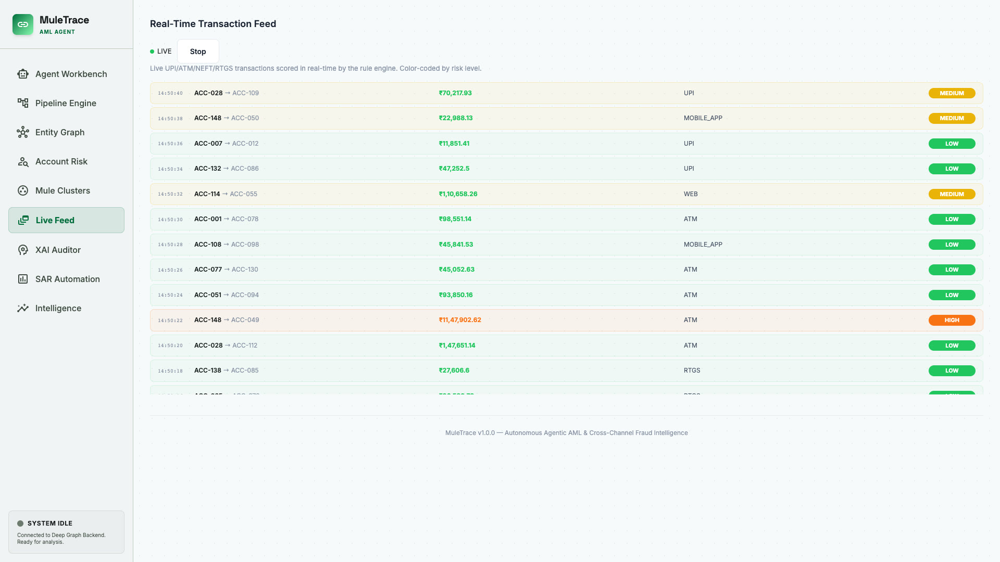
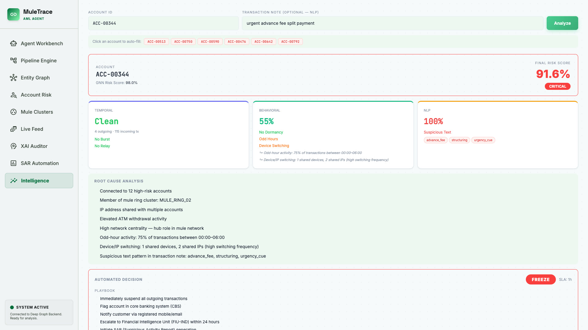
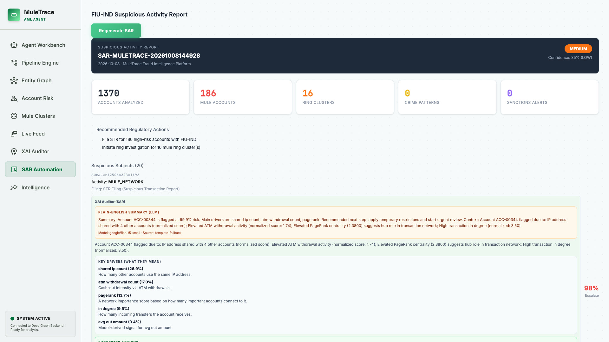

# MuleTrace — Autonomous Agentic AML & Cross-Channel Fraud Intelligence System

MuleTrace is an intelligent, **query-driven autonomous agent** designed to detect complex money laundering (AML) patterns and mule networks across multi-channel banking transaction data. Combining dynamic NLP intent parsing, selective tool orchestration, PyTorch Geometric Graph Neural Networks (GraphSAGE + GAT), and Gradient×Input feature attribution (XAI), MuleTrace delivers full explainability and automated Suspicious Activity Report (SAR) generation within a modern analyst workbench UI.

**Find the mule. Show the evidence. File the SAR.**

---

## 🎬 Demo Video

[](https://ac265640.github.io/mule-trace/)

▶️ **[Watch the 51-second demo](https://ac265640.github.io/mule-trace/)** (plays in your browser, 1080p with sound). Every scene is real footage of the running app, following one flagged account from a plain-English question to a drafted SAR:

| Time | Scene |
|---|---|
| 0:06 | **Pipeline Engine**: synthetic data → entity graph → GNN training → risk scoring in about 3.4 s |
| 0:10 | **Agent Workbench**: *"Is customer ACC-00344 suspicious?"* → a 98.0% mule probability, *Escalate*, 2/2 citations verified |
| 0:14 | **Account Risk** → **XAI Auditor**: ranked accounts, then *why* this one was flagged |
| 0:21 | **Entity Graph** and **Mule Clusters**: accounts, devices, IPs and ATMs in one graph, plus the detected mule rings |
| 0:28 | **Live Feed**: streaming transactions scored by the rule engine (shown as an 8× time-lapse) |
| 0:31 | **Intelligence**: temporal, behavioural and NLP signals fused into one risk score |
| 0:36 | **SAR Automation**: a FIU-IND Suspicious Activity Report, drafted in one click |
| 0:39 | MuleTrace presented live |

---

## 🖥️ Analyst Workbench Tour

The dashboard has nine tabs, each backed by the FastAPI endpoints listed in `backend/main.py`.

| Tab | What it does |
|---|---|
| **Agent Workbench** | Ask in plain English. The agent plans, runs only the tools it needs, and answers with inline evidence citations (`[E1]`, `[E2]`) and a verification badge. |
| **Pipeline Engine** | One click runs the full pipeline (data synthesis → unified entity graph → GraphSAGE + GAT training → risk analysis) and reports test AUC, average precision, flagged accounts and clusters. |
| **Entity Graph** | Interactive force-directed graph of accounts, mule accounts, devices, IPs and ATMs, with suspicious edges highlighted. |
| **Account Risk** | Every account ranked by GNN mule probability, with a recommended action and a one-click *Explain*. |
| **Mule Clusters** | Detected mule rings with member counts, density, volume, velocity, hub account and channels. |
| **Live Feed** | Server-sent-event stream of UPI / ATM / NEFT / RTGS / web transactions, scored in real time and colour-coded by severity. |
| **XAI Auditor** | Plain-English summary, key risk drivers, suggested actions and Gradient × Input feature attributions for a flagged account. |
| **SAR Automation** | Generates a FIU-IND-style Suspicious Activity Report with subjects, ring clusters, recommended regulatory actions and per-subject XAI. |
| **Intelligence** | Fuses GNN, temporal (burst/relay), behavioural (dormancy, odd hours, device switching) and NLP transaction-note signals into one final risk score, with root causes and an automated decision playbook. |

<details>
<summary><b>📸 Screenshots of all 9 tabs</b></summary>

| | |
|---|---|
|  **Pipeline Engine** |  **Agent Workbench** |
|  **Account Risk** |  **XAI Auditor** |
|  **Entity Graph** |  **Mule Clusters** |
|  **Live Feed** |  **Intelligence** |
|  **SAR Automation** | |

</details>

---

## 🏛️ Comprehensive Architecture

MuleTrace is built around a decoupled **Agentic Control Loop** that bridges natural language analyst queries with specialized graph intelligence, neural detection engines, and compliance tools.

```
                            Analyst Query (NL Input)
                                       │
                                       ▼
 ┌──────────────────────────────────────────────────────────────────────────┐
 │                         1. AGENT PLANNER ENGINE                          │
 │                       (backend/agent/planner.py)                         │
 │                                                                          │
 │  • Rule-Based & Keyword Intent Parser    • Parameter & Entity Extraction   │
 │  • Entity Resolution (Account IDs)       • Filter & Threshold Boundaries   │
 └─────────────────────────────────────┬────────────────────────────────────┘
                                       │
                                       ▼ Dynamic Execution Plan
 ┌──────────────────────────────────────────────────────────────────────────┐
 │                        2. AGENT TOOL REGISTRY                            │
 │                       (backend/agent/tools.py)                           │
 │                                                                          │
 │  ┌─────────────────┐  ┌──────────────────┐  ┌─────────────────────────┐  │
 │  │ Filter Data Tool│  │ Feature Eng. Tool│  │ Anomaly Detection Tool  │  │
 │  └────────┬────────┘  └────────┬─────────┘  └────────────┬────────────┘  │
 │  ┌────────┴────────┐  ┌────────┴─────────┐  ┌────────────┴────────────┐  │
 │  │ Risk Classifier │  │ Explanation Tool │  │  SAR Report Generator   │  │
 │  └─────────────────┘  └──────────────────┘  └─────────────────────────┘  │
 └─────────────────────────────────────┬────────────────────────────────────┘
                                       │
                                       ▼ Execution Pipeline
 ┌──────────────────────────────────────────────────────────────────────────┐
 │                      3. INTELLIGENCE & MODEL LAYER                       │
 │                                                                          │
 │  • Unified Entity Graph Builder (backend/graph/builder.py)               │
 │    Constructs NetworkX heterogeneity graph (Accounts, Devices, IPs, TXs) │
 │                                                                          │
 │  • PyTorch Geometric GNN Engine (backend/gnn/)                           │
 │    GraphSAGE + GAT hybrid model for topological mule cluster detection   │
 │                                                                          │
 │  • Behavioral Intelligence & Rules (backend/intelligence/)              │
 │    Structuring, rapid cash-out velocity, sub-threshold aggregation     │
 │                                                                          │
 │  • Gradient × Input XAI Explainer (backend/xai/explainer.py)             │
 │    Attributes risk scores to specific feature & graph topological inputs │
 └─────────────────────────────────────┬────────────────────────────────────┘
                                       │
                                       ▼ Structured Response
 ┌──────────────────────────────────────────────────────────────────────────┐
 │                    4. ANALYST WORKBENCH DASHBOARD                        │
 │                           (frontend/src/)                                │
 │                                                                          │
 │  • Real-Time Interactive Entity Graph (react-force-graph-2d)             │
 │  • Agent Execution Trace Visualizer & Query Workbench                    │
 │  • One-Click FIU-IND SAR Report Generation & Escalation                  │
 └──────────────────────────────────────────────────────────────────────────┘
```

### Detailed Component Overview

1. **Agent Planner Engine (`backend/agent/planner.py`)**:
   - Accepts free-text queries like *"Find structuring patterns in the last 30 days"* or *"Is customer ACC-00001 suspicious?"*.
   - Uses regex and semantic token classification to infer intent (`STRUCTURING_DETECTION`, `RAPID_CASHOUT`, `SHARED_DEVICE_RINGS`, `HIGH_FREQ_SUBTHRESHOLD`, `CROSS_CHANNEL_LAYERING`, `ENTITY_LOOKUP`).
   - Extracts parameters (date ranges, dollar thresholds, target entity IDs).

2. **Agentic Tool Registry (`backend/agent/tools.py`)**:
   - Encapsulates discrete analysis operations as stateless tool modules.
   - Evaluates dependencies and constructs a minimal, zero-redundancy execution plan.
   - Executes tools sequentially or in parallel, streaming intermediate state logs.

3. **Unified Entity Graph & GNN (`backend/graph/` & `backend/gnn/`)**:
   - Maps raw transaction logs into an entity-relationship graph connecting accounts, device fingerprints, IP subnets, and transaction channels.
   - Utilizes a PyTorch Geometric Graph Neural Network combining **GraphSAGE** (neighborhood feature aggregation) and **GAT** (Graph Attention Networks for weighted edge relationships) to detect hidden mule rings.

4. **Explainable AI (XAI) & SAR Automation (`backend/xai/` & `backend/intelligence/`)**:
   - Generates exact feature attribution scores using Gradient×Input methods so analysts understand *why* an alert triggered.
   - Formats findings directly into regulatory-compliant FIU-IND Suspicious Activity Reports (SAR).

---

## 🤖 What Makes This Agentic (Hackathon Requirement)

Unlike static ML pipelines that process all data through rigid sequential steps, MuleTrace behaves **agentically**:

- **Dynamic Execution Planning**: Evaluates query requirements and invokers *only* the subset of tools required.
- **Adaptive Execution Paths**:
  - `Query`: *"Find structuring patterns under $10,000"* ➔ **Plan**: Runs Data Filter ➔ Structuring Detector ➔ XAI Explainer (skips GNN model inference).
  - `Query`: *"Detect shared device mule rings"* ➔ **Plan**: Runs Graph Builder ➔ GNN Inference ➔ Cluster Profiler (skips single-entity rules).
  - `Query`: *"Is ACC-00005 suspicious?"* ➔ **Plan**: Runs Entity Lookup ➔ Feature Attribution ➔ Immediate Risk Scoring.
- **Transparent Trace Logs**: Every tool invocation, parameter, and execution duration is logged and returned in the API response for full analyst auditability.

---

## 🛡️ Evidence-Grounded Answers & Guardrails

The agent shouldn't guess about someone's bank account. Two layers make sure it doesn't.

**Citation enforcer (`backend/agent/citation.py`)**: every claim must trace back to a concrete evidence record (a rule definition, a dataset aggregate, a transaction or a model score), cited inline as `[E1]`, `[E2]`, and so on. After the answer is written and before the analyst sees it, the enforcer checks:
1. **Confidence threshold**: below it, the agent declines rather than guesses.
2. **Minimum citations**: an uncited answer can't be verified.
3. **Citation validity**: every cited ID must exist in the evidence registry, which catches hallucinated citations.
4. **Claim coverage**: every sentence that states a number must cite evidence.
5. **Numeric grounding**: every number must appear in the evidence it cites, which catches fabricated figures.

If any check fails, the answer is withheld and the agent refuses instead. Answers that pass are shown with a badge such as *"2/2 citations verified · 2 numeric claims checked against evidence"*.

**Guardrails (`backend/agent/guardrails.py`)**: three gates around the agent:
1. **Input guard**: refuses prompt injection, requests to evade AML controls or tip off subjects, requests for customer personal data, and anything outside the AML domain.
2. **Pre-generation decline**: refuses when there is nothing to ground an answer in (no dataset, no trained model, or an unknown account) instead of fabricating a risk profile.
3. **Output guard**: scrubs PII from the narrative and adds an analyst-review disclaimer.

Refusals come back with suggested queries that will work, and the workbench shows them as a refusal card.

---

## 🧪 Detected AML Patterns

| Pattern | Description | Detection Method |
|---|---|---|
| **Structuring / Smurfing** | Multiple sub-$10,000 deposits engineered to bypass regulatory reporting thresholds. | Sub-threshold rule filter + IQR distribution anomaly detection |
| **Rapid Cash-Out Velocity** | High-value incoming digital deposit (e.g., Mobile/Web) followed by instant ATM withdrawal within 2–8 minutes. | Graph edge temporal delta analysis |
| **Shared Device Mule Rings** | Groups of distinct account holders sharing common device fingerprints, IMEI numbers, or IP subnets. | NetworkX topological clustering & device co-occurrence graphs |
| **High-Frequency Sub-Threshold** | Accounts executing ≥10 transfers just below reporting thresholds within a 30-day window. | Aggregation windowing rule |
| **Cross-Channel Layering** | Money movement spanning UPI, Mobile Banking, Web, and Cash Out across multi-hop node chains. | PyTorch Geometric GraphSAGE + GAT hybrid neural inference |

---

## 📂 Dataset Documentation & Schema

MuleTrace operates on a multi-entity synthetic dataset modeling realistic retail banking transaction streams and money laundering topographies.

> **Hackathon Compliance Note:** No real customer PII is used. Data is synthetically generated following schema and behavioral distributions from established industry benchmarks:
> - [Kaggle — IEEE-CIS Fraud Detection](https://www.kaggle.com/c/ieee-fraud-detection)
> - [PaySim Financial Crime Benchmark](https://www.kaggle.com/datasets/ealaxi/paysim1)
> - [IBM AML Transactions Dataset](https://www.kaggle.com/datasets/ealtman2019/ibm-transactions-for-anti-money-laundering-aml)
> - [FATF AML Guidance Standards](https://www.fatf-gafi.org)

### Accounts Table (`accounts.csv`)

| Field | Type | Description |
|---|---|---|
| `account_id` | `string` | Unique account identifier (e.g. `ACC-00001`) |
| `holder_name` | `string` | Synthetic customer name |
| `jurisdiction` | `string` | 2-letter ISO country code (e.g. `IN`, `US`, `AE`, `PH`) |
| `jurisdiction_risk_weight` | `float` | Risk score tier derived from FATF guidance (0.1 – 0.6) |
| `account_type` | `enum` | Account type (`SAVINGS`, `CURRENT`, `WALLET`) |
| `is_mule` | `bool` | Synthetic ground-truth label (injected during synthetic generation) |

### Transactions Table (`transactions.csv`)

| Field | Type | Description |
|---|---|---|
| `transaction_id` | `string` | Unique transaction identifier (e.g. `TX-000101`) |
| `source_account` | `string` | Sending account ID |
| `target_account` | `string` | Receiving account ID or `ATM-CASH-OUT` |
| `amount` | `float` | Transaction amount in USD |
| `channel_type` | `enum` | Channel (`UPI`, `ATM`, `WEB`, `MOBILE_APP`) |
| `timestamp` | `ISO-8601` | Transaction timestamp (`YYYY-MM-DDTHH:MM:SS`) |
| `is_suspicious` | `bool` | Synthetic ground-truth flag |
| `pattern_type` | `string` | AML pattern tag (`NORMAL`, `STRUCTURING`, `RAPID_CASHOUT_DEPOSIT`, `RAPID_CASHOUT_ATM`) |

---

## 🛠️ Tech Stack

| Layer | Technology | Version / Notes |
|---|---|---|
| **Backend & API** | Python / FastAPI / Uvicorn | Python 3.10+, FastAPI 0.115 |
| **Agent Orchestrator** | Custom Agent Planner & Tool Registry | Native Python, asynchronous execution |
| **Graph Intelligence** | NetworkX | Unified Entity Graph topology building |
| **Neural Network Engine** | PyTorch & PyTorch Geometric | GraphSAGE + GAT hybrid model |
| **Explainable AI (XAI)** | Custom Feature Attribution Engine | Gradient × Input feature importance |
| **SAR Automation** | FIU-IND Compliant Generator | Structured SAR JSON/PDF exporter |
| **Trust Layer** | Citation enforcer + guardrails | Evidence-grounded answers, refusal on low confidence or unsafe input |
| **Frontend UI** | React 19 + Vite + Tailwind + custom CSS | Light analyst-workbench theme |
| **Graph Visualization** | `react-force-graph-2d` | Real-time interactive node-link network rendering |

---

## 🚀 Local Setup & Run Guide

Follow these step-by-step instructions to clone, set up, and run MuleTrace on your local machine.

### Prerequisites

Ensure you have the following installed on your system:
- **Git** (`git --version`)
- **Python 3.10+** (`python3 --version`)
- **Node.js 18+** & **npm** (`node -v` and `npm -v`)

---

### Step 1: Clone the Repository

```bash
git clone https://github.com/ac265640/mule-trace.git
cd mule-trace
```

---

### Step 2: Set Up Python Backend Virtual Environment

It is recommended to use a virtual environment to manage backend dependencies cleanly:

**Mac / Linux:**
```bash
python3 -m venv venv
source venv/bin/activate
```

**Windows (PowerShell):**
```powershell
python -m venv venv
.\venv\Scripts\Activate.ps1
```

---

### Step 3: Install Backend Dependencies

Upgrade `pip` and install all required Python libraries:

```bash
pip install --upgrade pip
pip install -r backend/requirements.txt
```

> **Note on PyTorch / PyTorch Geometric**:
> `backend/requirements.txt` installs CPU-compatible PyTorch automatically. If you encounter any installation warnings related to `torch-geometric`, run:
> ```bash
> pip install torch --index-url https://download.pytorch.org/whl/cpu
> pip install torch-geometric
> ```

---

### Step 4: Launch the FastAPI Backend Server

Run the Uvicorn dev server from the repository root:

```bash
python -m uvicorn backend.main:app --reload --port 8000
```

Once started, verify the backend is active by opening your browser or visiting:
- **API Base**: `http://localhost:8000`
- **Swagger Interactive API Documentation**: [http://localhost:8000/docs](http://localhost:8000/docs)
- **Preset Queries API**: `http://localhost:8000/api/agent/preset-queries`

---

### Step 5: Install & Launch the React Frontend

Open a **new terminal window/tab**, navigate to the `frontend/` folder, install npm packages, and start the Vite dev server:

```bash
cd frontend
npm install
npm run dev
```

The application will start immediately. Open your browser and navigate to:
👉 **`http://localhost:5173`**

---

## 🧪 How to Test the Agent

You can test MuleTrace using either the **Agent Workbench** tab in the web dashboard or directly via terminal `curl` commands.

### Option A: Via Web Workbench Dashboard (`http://localhost:5173`)
1. Open **Pipeline Engine** in the sidebar and click **Run Full Pipeline**. It takes a few seconds. Data is regenerated on every run, so account IDs change.
2. Open **Account Risk** and copy a top-ranked account ID.
3. Open **Agent Workbench**, click a suggested investigation card or type a query such as *"Is customer ACC-xxxxx suspicious?"*, and click **Run**.
4. Check the cited answer, the verified-citations badge and the evidence sources. Expand **Agent Reasoning, Guardrails & Execution Steps** to see the plan.
5. Explore the other tabs: **Explain** an account in XAI Auditor, **Load Graph**, **Start Feed**, **Analyze** in Intelligence, and **Generate SAR**.

### Run the automated tests

```bash
python -m pytest backend/tests -q
```

The suite covers the guardrails and the citation enforcer: refusals for prompt injection and AML evasion, declines when there's no data or no trained model, grounded answers passing enforcement, and rejection of hallucinated citations, fabricated numbers, uncited claims and low-confidence answers.

### Option B: Via Terminal `curl` Commands

**Test 1: Structuring Detection Query**
```bash
curl -X POST http://localhost:8000/api/agent/query \
  -H "Content-Type: application/json" \
  -d '{"query": "Find structuring patterns in the last 30 days"}'
```

**Test 2: High-Frequency Sub-Threshold Query**
```bash
curl -X POST http://localhost:8000/api/agent/query \
  -H "Content-Type: application/json" \
  -d '{"query": "Which customers made 10+ transactions under $10,000?"}'
```

**Test 3: Single Entity Suspicion Investigation**
```bash
curl -X POST http://localhost:8000/api/agent/query \
  -H "Content-Type: application/json" \
  -d '{"query": "Is customer ACC-00001 suspicious?"}'
```

---

## 📊 Sample Agent API Response Format

Every query to `/api/agent/query` returns a structured JSON response containing intent details, dynamic execution plan, logs, and findings:

```json
{
  "query": "Find structuring patterns in the last 30 days",
  "intent": "STRUCTURING_DETECTION",
  "target_entity": null,
  "filters": {
    "max_amount": 10000.0,
    "min_amount": 8000.0
  },
  "execution_plan": [
    { "step": 1, "tool": "Filter_Data_Tool", "reason": "Apply $10,000 regulatory reporting filter" },
    { "step": 2, "tool": "Feature_Engineering_Tool", "reason": "Calculate sub-threshold velocity features" },
    { "step": 3, "tool": "Anomaly_Detection_Tool", "reason": "Run IQR anomaly detection on sub-threshold transfers" },
    { "step": 4, "tool": "Explanation_Tool", "reason": "Generate XAI reasons for structuring flags" }
  ],
  "execution_logs": [
    "Filtered 1,250 transactions down to 48 sub-threshold candidates",
    "Identified 5 structuring clusters attempting regulatory evasion"
  ],
  "execution_time_ms": 14.2,
  "tool_results": {
    "structuring_transactions": [],
    "summary": "Detected sub-threshold transfers attempting regulatory evasion."
  }
}
```

---

## ❓ Troubleshooting & FAQs

#### Q1: Backend fails with `ModuleNotFoundError: No module named 'backend'`
**Fix**: Ensure you run `uvicorn` as a module from the repository root directory:
```bash
python -m uvicorn backend.main:app --reload --port 8000
```

#### Q2: Frontend cannot connect to the backend (CORS or Network Error)
**Fix**: Ensure the backend server is running on `http://localhost:8000`. The frontend Vite dev server automatically proxies API requests to port 8000.

#### Q3: `npm install` throws peer dependency warnings
**Fix**: Legacy peer warnings can be ignored, or install with legacy peer flag:
```bash
npm install --legacy-peer-deps
```

---

## 📜 Regulatory & Code of Conduct Alignment

- **Regulatory Compliance**: Adheres to FinCEN $10,000 Currency Transaction Reporting (CTR) guidance and FATF global risk scoring benchmarks.
- **FIU-IND SAR Standard**: Automated SAR generation follows standard Suspicious Activity Report fields.
- **Ethics & Privacy**: 100% synthetic dataset. Zero real-world PII or institution-specific data is contained or used.
- **Originality**: All system components were developed during the hackathon window.
